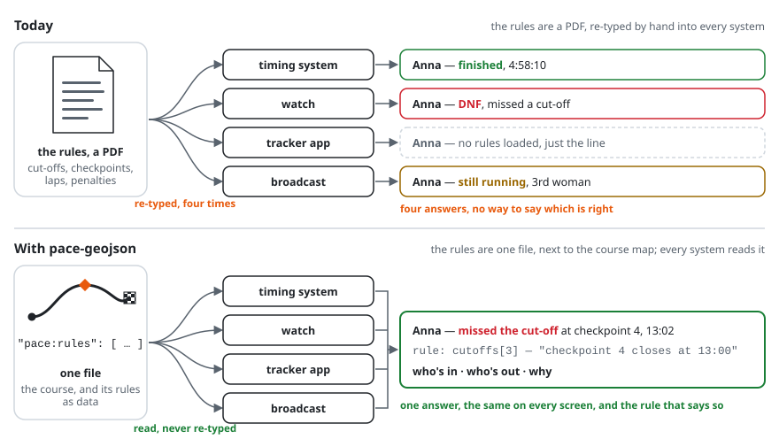
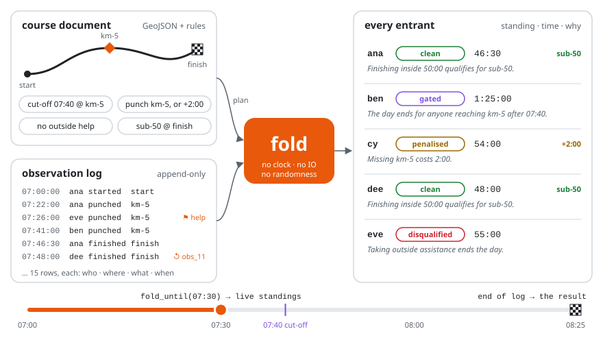

<p align="center">
  <picture>
    <source media="(prefers-color-scheme: dark)" srcset="docs/assets/logo-dark.svg">
    
  </picture>
</p>

<h3 align="center">The rules of an endurance event, as one file any software can run.</h3>

<p align="center">
  
  
  
</p>

Every race has rules — cut-offs, checkpoints, laps, penalties. Today they live in a PDF, and every
timing company, tracker app and watch re-types them its own way. So the same runner can be "in" on
one screen and "DNF" on another, and nobody can say which is right.

**pace-geojson is that rulebook written as a file, next to the course map.** The timing tent, the
tracker and the watch read the same rules and give the same answer — who's in, who's out, and the
rule that says so.

<picture>
  <source media="(prefers-color-scheme: dark)" srcset="docs/assets/today-vs-pace-geojson-dark.svg">
  
</picture>

## What it is

- **One file per event.** The course — any map draws it, the way it draws a GPX — and its rules: cut-offs, checkpoints, laps, penalties, awards, filled in as data from the rulebook the runners already read. By the organiser, or by their timing company.
- **Any event.** A city marathon, a 100-mile trail ultra, a backyard ultra, a triathlon, an orienteering race, a 500 km sportive: one way to write the rules of any of them, however custom.
- **One answer.** Live standings mid-race and the official result come from the same file and the same timing data, so they cannot disagree. A late chip read or an upheld protest is added to the record; nothing already recorded is rewritten.
- **Every verdict says why.** Not "DNF" — the sentence of the rule that ended the race.
- **Refuses rather than guesses.** A rule the software does not recognise, or one nobody could ever meet, is caught before race day, not dropped silently during it.
- **Open, on purpose.** Apache-2.0, with a patent grant any vendor's lawyers can approve. Two independent scoring engines (Rust and TypeScript) agree on every public test case; the repository is github.com/turbotobias/pace-geojson.

## Who it's for

- **Organiser** — write the rules once (or have your timing company do it), then rehearse them on 1 000 simulated runners before race day: [rehearsal](docs/rehearsal.md).
- **Timing system** — keep your hardware, emit one row per sighting, import the rules instead of re-keying them; when a DNF is disputed, everyone points at the same line: [implementing it](docs/implementing.md).
- **Watch maker** — load the event, not just the line: time to the next cut-off on the wrist, from the same rules official timing uses, computed on the device with no network: [API](docs/api.md).
- **Participant** — your watch, the timing tent and the tracker agree, and the result names the rule that ended your race, not just "DNF": [reading a result](docs/results.md).
- **Spectator** — the live standings and the official result come from the same file, with the "why" attached: [live, and after the fact](docs/results.md#live-and-after-the-fact).
- **Developer** — a small format plus a reference engine: file + timing rows in, states out, no clock, no network: [the data model](docs/data-model.md) · [API](docs/api.md).
- **Investor** — an open standard that sits under every timing company, watch and broadcaster, free so that all of them can adopt it; the business is what runs on top: [why a format](docs/why.md).

## How it works

<picture>
  <source media="(prefers-color-scheme: dark)" srcset="docs/assets/how-it-works-dark.svg">
  
</picture>

1. The organiser, or their timing company, writes the rules into the course file. Any map still draws it.
2. `plan` checks every rule is known and can be met, or refuses with every reason — weeks before the start.
3. On the day, timing chips, trackers, a marshal's tablet or a watch file each add rows to one log: who was seen where, when.
4. `fold` — the one function that turns the log into results — applies every rule to every row. A correction is a new row that supersedes an old one; the order rows arrive in never matters.
5. Out comes every participant's standing, time and awards, and the sentence of the rule why. Stop the fold at any instant for the live standings; run it to the end for the official result.

<details>
<summary><b>See it work</b> — one file, one rule, one read, one verdict</summary>

The whole event is one file, [examples/10k/document.json](examples/10k/document.json):

```jsonc
// excerpt of examples/10k/document.json
{ "type": "FeatureCollection", "pace-geojson": 1, "pace:dialects": ["athletics@1"],
  "pace:path": [{ "line": "ln_1", "from_m": 0, "to_m": 10000, "repeat": 1 }],
  "pace:rules": [
    // four rules: a cut-off, a station, no outside help, a qualifying time
  ],
  "features": [
    // the line, and the places along it: start, km-5, finish
  ] }
```

One of its four rules, a cut-off at 5 km:

```jsonc
// examples/10k/document.json#/pace:rules/0
{ "id": "rul_gate", "dialect": "athletics@1", "kind": "cutoff_at", "ordinal": 0,
  "at": { "point": "km-5", "along_m": 5000 },
  "params": { "at": "2027-05-02T07:40:00.000Z", "says": "07:40" } }
```

The timing point at 5 km sees `ent_ben`, one row of [examples/10k/log.json](examples/10k/log.json):

```jsonc
// examples/10k/log.json#/8
{ "id": "obs_09", "entrant": "ent_ben", "at": { "point": "km-5", "along_m": 5000 }, "kind": "punched",
  "t": "2027-05-02T07:41:00.000Z", "quantity_name": null, "quantity_value": null, "flags": [],
  "source": "transponder", "device": "dev_km5", "confidence": 1, "supersedes": null }
```

The row `fold` writes for him:

| entrant | standing | total | why |
| --- | --- | --- | --- |
| `ent_ben` | **gated** | 1:25:00 | The day ends for anyone reaching km-5 after 07:40. |

At 07:40:00.000 he'd have been clean; at 07:40:00.001, gated. When a backup reader's file turns
up an hour late with `ent_cy` at 5 km, you append one row and fold again: penalised becomes clean,
and nothing was edited. Rehearsed on 1 000 simulated runners, the station rule fired 15 times, every
one a read the timing point dropped: found before the race, not in 15 protests after it. The whole
race, five runners and four rules: [one event, end to end](docs/one-event.md).

</details>

## Getting started

Nothing is on crates.io or npm yet (0.1.0 is unreleased): clone `https://github.com/turbotobias/pace-geojson` and run from its root.

- [Rust](docs/api.md#rust-quick-start) — `cargo run --example quickstart`
- [TypeScript](docs/api.md#typescript-quick-start) — `npm ci` in `ts/`, then `node ts/examples/quickstart.ts`
- [WebAssembly](docs/api.md#webassembly) — the Rust engine in a browser or Node
- [The specification](SPEC.md) — every law, every signature
- [The corpus](corpus/) — 19 conformance cases and 54 decode cases both engines must pass; the corpus *is* the spec

## Go deeper

[Why a format](docs/why.md) · [One event, end to end](docs/one-event.md) · [The data model](docs/data-model.md) · [Reading a result](docs/results.md) · [Rules and dialects](docs/rules.md) · [Rehearsal](docs/rehearsal.md) · [API](docs/api.md) · [Implementing it](docs/implementing.md) · [Scope and versioning](docs/scope.md) · [Guarantees](docs/guarantees.md) · [Known gaps](docs/known-gaps.md) · [Contributing](CONTRIBUTING.md) · [Governance](CONTRIBUTING.md#governance) · [Changelog](CHANGELOG.md)

## Licence

Apache-2.0 for everything — code, specification and corpus ([LICENSE](LICENSE), [NOTICE](NOTICE)).
The patent grant is deliberate: a format only becomes a standard if a company's lawyers can approve
implementing it. Contributions come in under the same licence and grant.
